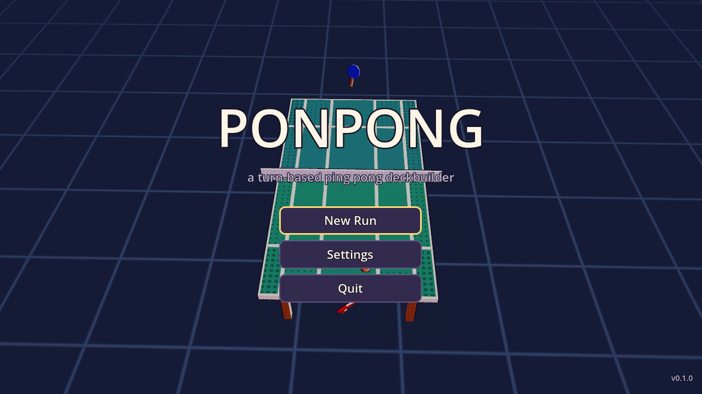
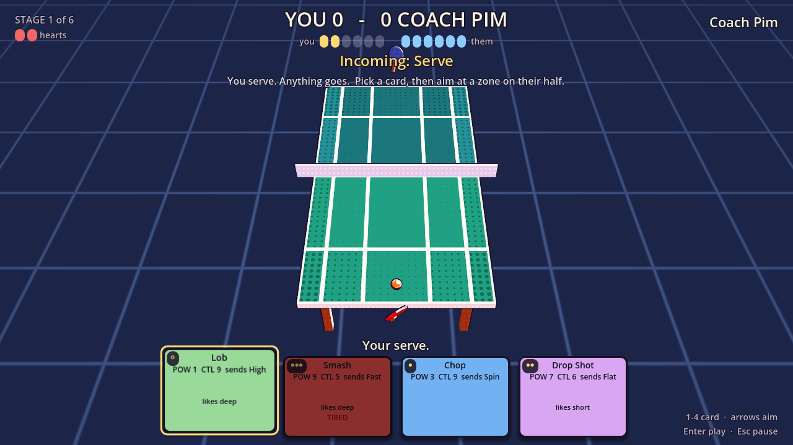
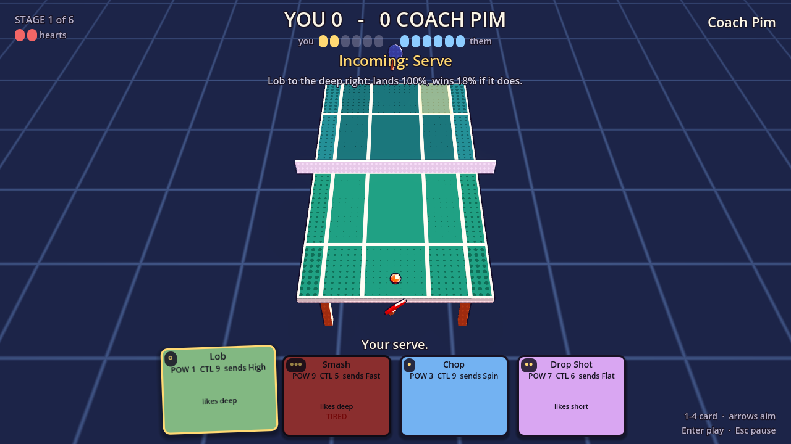
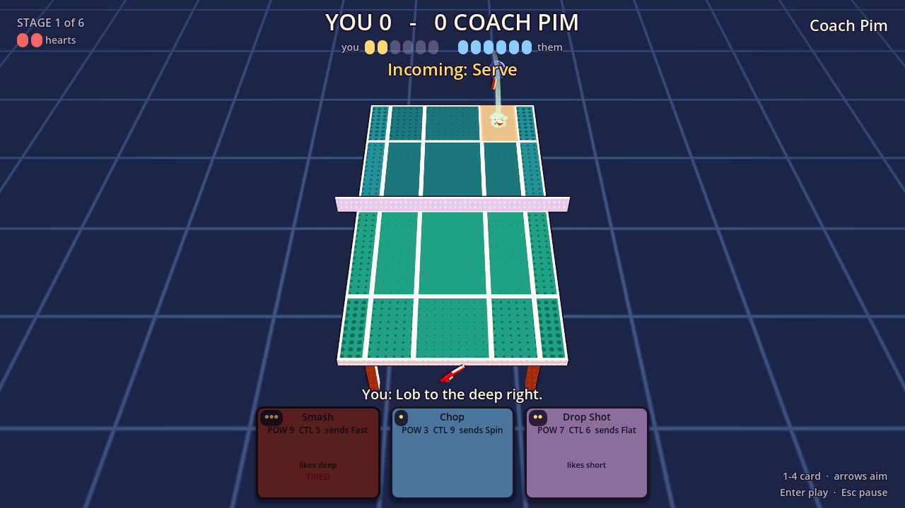
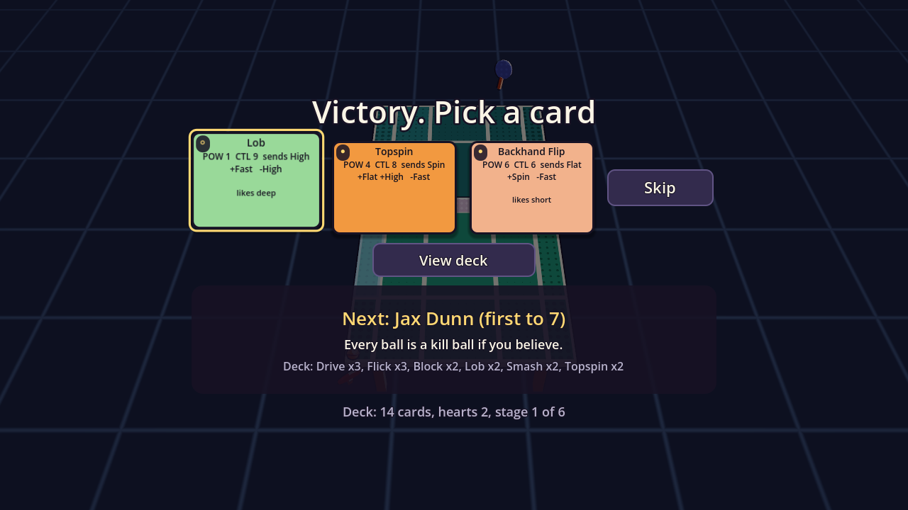
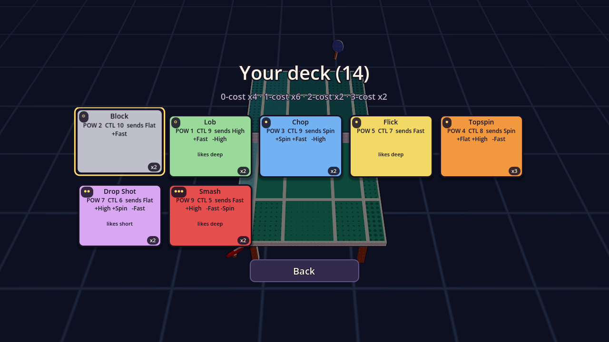

# ponpong

A turn-based ping pong deckbuilder in stylised 3D, built with Godot 4.

There is no physics. A rally is a sequence of card plays: you pick a shot card
against the incoming ball, aim it at one of ten zones on the opponent's half,
and the resolver decides whether it lands, wins outright or comes back. The 3D
scene then plays the shot back by tweening the ball along a curve, with a toon
shader, synthesised sound, hit stop, a ball trail and particles, none of it
from asset files. A run is six matches against a roster of nine opponents,
with cards won between them. It plays with a mouse, a keyboard or a gamepad.

## Open it

1. Install [Godot 4.6 or newer](https://godotengine.org/download). It was made
   with 4.6 and runs on 4.7. The standard build is enough, no .NET needed.
2. In the Godot project manager choose **Import**, pick this folder's
   `project.godot`, then **Import & Edit**.
3. Press **F5** (or the play button) to run `scenes/main.tscn`.

The first import takes a few seconds while shaders compile.

## Play a run

**New Run** draws six opponents from the run's seed: Coach Pim first, then two
of the three tier-A opponents, two of the three tier-B opponents, and one of
the two bosses. The VS banner and the reward screen scout whoever is next
(name, blurb, first-to-N, their deck as "Lob x5, Block x3, ..."), so every card
you pick is picked knowing who it is for. Stage 1 is first to 5, stages 2-5
first to 7, the boss first to 9. Serve switches every two points.

You have **two hearts**. Losing a match costs one and you rematch the same
opponent; before the rematch the Deck screen opens for a **regroup**, an
optional removal of one card. Losing with no hearts left ends the run.

Winning a match offers a **reward**: one of three cards, or Skip. After
stages 2 and 4 the reward screen also offers a **trim** ("Remove a card
instead"), which swaps the pick for the Deck screen in remove mode. Early
rewards are mostly commons (60/30/10 common/uncommon/rare), later ones lean
rarer (45/35/20). The deck starts at 14 cards, never goes below 10 and never
above 20. Beating the boss wins the run; the run end screen shows the seed, and
"Retry this seed" replays the same six opponents; the match seeds and reward
offers repeat for as long as your results do (a lost match re-rolls what
follows).

### A point

Each half of the table is a 2 by 5 grid of target zones: five lanes across,
two rows deep. The far-left and far-right lanes are thin and the deep row by
the end line is shallow, because those are the balls that go out; risky zones
wear halftone dots, and the bigger the dots the easier the zone is to miss.
The top of the screen shows the score, both stamina pools and the **incoming
ball**: its type (Flat, High, Spin or Fast) and where it lands on your half.
Awkward landing zones cost you control on the reply. Your hand is four cards,
each listing power, control, the ball it sends and whether it is strong or
weak against the incoming one; some cards want a row (Drop Shot the short
row, Smash and Lob the deep row). Pick a card, aim at a zone and the hint line
gives the odds: how likely it lands, and how likely it wins outright if it
does. Darker zones are the lanes the opponent is covering. Commit, and the
roll decides: a fault into the net or out, a winner, or a ball that comes
back as your next incoming.

### Stamina

Every card costs 0 to 3 stamina (the dots on the card; a hollow dot is free).
Both players start a match at 6, get 1 back at the start of every point and
carry the pool across points. You may always play a card you cannot afford:
it empties your pool and the shot is **tired**, a flat 0.25 off its quality
that the hint line and the greyed card both warn you about. From 6 you can
Smash twice, then you are at 0 and the third Smash would be tired, so play
cheap until you have caught your breath. The opponent's pool is always
visible too: "they are at 1" is information you play around.

### Keywords

Six keywords, on eleven of the 25 cards, do one extra thing, and the card
says which:

| Keyword | Card text | What happens |
| --- | --- | --- |
| Rest | Rest: +2 stamina. | After paying its cost you get 2 back (cap 6). |
| Sap | Sap: they lose 2 stamina. | If the shot lands, the opponent loses 2 (floor 0). |
| Exhaust | Exhaust: once per match. | The card leaves the match instead of going to the discard. |
| Steady | Steady: half the zone risk. | Risky zones cost this card half as much quality. |
| Reach | Reach: awkward balls do not matter. | Ignores where the incoming ball landed, heavy balls included. |
| Heavy | Heavy: their reply is harder. | If it comes back, their reply is as awkward as a deep-edge ball. |

### The roster

| Opponent | Where | How they play |
| --- | --- | --- |
| Coach Pim | opener, first to 5 | Blocks, pushes, chops and five lobs, picked loosely. A gift to smash. |
| Mara "Chopper" Vale | tier A | Chops, line chops, pushes, fish and blocks. Never attacks; waits for your fault. |
| Jax Dunn | tier A | Smashes, drives and flicks at the deep row, all out, every ball. |
| Dot & Dash | tier A | Lobs, fish and moonballs that sap you, then drop shots and backhand flips short. |
| Oona Sato | tier B | Loops, banana flicks and chops between lobs: spin on everything she can, and heavy replies. |
| Big Rig | tier B | Counter drives, drives and angle drives at the lines, with a flat kill in reserve. |
| Kit Marlow | tier B | Ace serves, kick serves, drop shots, angle drives and a last gasp, all aimed at the edges. |
| Ilse Varga, Champion | boss, first to 9 | A 16-card deck of loops, heavy chops, counter drives and a power loop, and the greediest aim in the game. |
| Your Shadow | boss, first to 9 | Your own deck, played back at you greedily. |

## Controls

Godot's built-in `ui_accept` (Enter, Space, A), `ui_cancel` (Esc, B) and
`ui_left/right/up/down` (arrows, d-pad, left stick) are used as they come;
`scripts/input_setup.gd` registers the rest at boot and adds WASD to the
`ui_*` set, so menus take it too. A gold ring marks what has focus on every
screen and the hint under the hand switches wording when a gamepad is used.

| Action | Keyboard | Gamepad | Mouse |
| --- | --- | --- | --- |
| Pick a card | 1 2 3 4, or Enter / Space on the focused card | A on the focused card | left click |
| Move over the cards | Left / Right | d-pad / stick | hover |
| Previous / next card | Q / E | LB / RB | |
| Move the zone cursor | arrows / WASD (Up is the deep row, since their half is at the top) | d-pad / stick | hover |
| Play into the zone | Enter / Space | A | left click |
| Un-pick the card | Backspace | B | right click |
| Pause | Esc | Start | |
| Fullscreen | F11 | | |
| Menus | arrows + Enter, Esc = back | d-pad + A, B = back | click |

The zone cursor starts at the short middle and keeps its last position within
a match; moving the mouse moves the same cursor, so the two never disagree.

## Settings

Settings (from the main menu or the pause menu) has a master volume slider and
Fullscreen and Screen shake switches. Every change applies at once and Back
saves them to `user://settings.cfg`; F11 toggles fullscreen from anywhere and
saves too. A run in progress is saved to `user://run.json` after every
decision (a match is never saved mid-way: Continue restarts that match), and
the main menu shows **Continue** while that file exists. Abandoning a run or
finishing it deletes the file. On Windows `user://` is
`%APPDATA%\Godot\app_userdata\ponpong\`; on Linux it is
`~/.local/share/godot/app_userdata/ponpong/`.

## Build for Windows

`export_presets.cfg` carries one preset, **Windows Desktop**: x86_64, the
`.pck` embedded in the exe, no code signing, no resource editing (so the exe
wears Godot's icon and no rcedit is needed), `docs/`, `tests/` and `tools/`
left out. Export templates are needed once: **Editor > Manage Export
Templates > Download and Install**. Then either

- **Project > Export > Windows Desktop > Export Project**, or
- from a shell in this folder:

```sh
godot --headless --path . --export-release "Windows Desktop" export/ponpong.exe
```

`export/` is gitignored. Without the templates the command fails with "No
export template found"; any other error means the preset itself is broken.

## Headless checks

The scripts under `tests/` and `tools/` run without the editor and are what CI
would call. `--fixed-fps 60` is a test flag only: it drops real-time sync so a
whole run takes seconds. Every run should be grepped for `SCRIPT ERROR`,
`Parse Error` and `ERROR:` (Godot's own "ObjectDB instances leaked" line on
exit is noise).

```sh
G=godot                                                    # or the path to the binary
$G --headless --path . --import 2>&1 | tail -3             # imports; no SCRIPT ERROR / Parse Error
$G --headless --path . -s tests/determinism.gd             # match rules: same seed + actions = same match
$G --headless --path . -s tests/run_determinism.gd         # run rules, card pool and roster integrity
$G --headless --path . -s tests/balance.gd -- --runs 40    # starter vs every opponent: report + loose bounds
$G --headless --path . -s tests/screens.gd                 # every screen and CardView from synthetic args
$G --headless --fixed-fps 60 --path . -s tests/autoplay.gd # whole runs through the menus, pauses, aims
sh tools/check_rules_pure.sh                               # rules files never touch global RNG, nodes or time
$G --headless --path . -s tools/card_table.gd              # the card table below, as Markdown
LIBGL_ALWAYS_SOFTWARE=1 xvfb-run -a -s "-screen 0 1280x720x24" \
  $G --path . --rendering-driver opengl3 -s tests/screenshot.gd -- /abs/out   # PNGs of every screen
```

On Windows the same commands run in PowerShell with the console build, for
example `& 'C:\Godot\Godot_v4.7.2-stable_win64_console.exe' --headless --path . -s tests/determinism.gd`;
`tests/screenshot.gd` runs there directly, without `xvfb-run` or
`LIBGL_ALWAYS_SOFTWARE`.

`tests/balance.gd` prints a win-rate table for the starter deck against every
opponent (with each one's target band), and per-card play, tired, land, winner
and point-won rates; it only asserts loose bounds so it stays green while
numbers move. `tests/screenshot.gd` needs a display, virtual or real, and
writes one numbered PNG per screen, `01_menu.png` first.

## Where things are

| Path | What it is |
| --- | --- |
| `scenes/main.tscn` | The root: the Director, one Match instance, the Screens layer and the Sfx node. |
| `scenes/match.tscn` | The match: table, paddles, ball, trail, impact particles, camera, HUD, VisualFx. |
| `scripts/director.gd` | The run loop: owns the RunState, starts matches, shows screens, pauses, saves and loads. |
| `scripts/game.gd` | The match presenter (`MatchScene`): feeds actions to the state, plays back events, emits `fx`. |
| `scripts/run_state.gd` | Pure, seeded, serialisable run: opponents, hearts, rewards, trims. |
| `scripts/opponent_library.gd` | The nine opponents: decks, AI personalities, paddle colours. |
| `scripts/match_state.gd` | Pure, seeded, serialisable match: decks, hands, stamina, points. The thing to run on both peers. |
| `scripts/rally_resolver.gd` | Pure logic: card + incoming ball + target zone + opponent lane into odds and an outcome. |
| `scripts/ai_controller.gd` | Picks actions for a computer player from the odds, shaped by personality params. |
| `scripts/card.gd` | The `Card` resource: power, control, cost, rarity, keyword, matchups, flight shape. |
| `scripts/card_library.gd` | All 25 cards, the starter deck, the rarity pools and the id lookups. Add cards here. |
| `scripts/ball_type.gd` | The four ball types and their labels. |
| `scripts/zone_layout.gd`, `scripts/zone.gd` | The 2x5 zones per half as data: geometry, risk and reward. |
| `scripts/zone_grid.gd` | Draws a ZoneLayout on the table and tints zones by state. |
| `scripts/ball_flight.gd` | Tweened quadratic-curve ball movement, bounce squash, net fault. |
| `scripts/hand_ui.gd` | The hand: a focusable strip of CardViews. |
| `scripts/input_setup.gd` | Registers the keyboard, mouse and gamepad actions at boot. |
| `scripts/settings.gd` | Master volume, fullscreen and screen shake as statics; reads and writes `user://settings.cfg` and applies them to the engine. |
| `scripts/screens/` | Main menu, pause, settings, match end, reward, deck and run end, all code-built. |
| `scripts/ui/` | `UiKit` (palette and widget builders), `UiScreen` (screen base), `CardView` (one card face). |
| `scripts/sfx.gd` | Every sound, synthesised at boot from small recipes; listens to the match's `fx` signal. |
| `scripts/feel.gd` | Hit stop and the base time scale. |
| `scripts/visual_fx.gd` | Reacts to `fx`: camera, trail, particles, paddle squash, net wobble, zone flashes, score pop, pips. |
| `scripts/camera_rig.gd` | The match camera: shake, fov punch, lean, dolly, menu orbit, end push-in. |
| `scripts/ball_trail.gd` | The ribbon behind the ball in flight. |
| `scripts/impact_fx.gd` | The bounce puff, the table ring and the net puff. |
| `shaders/` | `toon` (the look), `outline` (inverted hull), `zone` (fill, risk halftone, flash), `ring` (impact ring), `floor` (grid). |
| `materials/*.tres` | One toon material per surface, so colours tune in the inspector. |
| `tests/` | The headless checks above. |
| `tools/check_rules_pure.sh` | Greps the rules files for anything that would break determinism. |
| `tools/card_table.gd` | Prints the card table below from `CardLibrary`. |
| `export_presets.cfg` | The Windows Desktop export preset. |

## Design notes

**Rules and pictures are separate.** `MatchState` is the whole game with no
nodes in it: two players with decks, hands, stamina and scores, whose turn it
is, the incoming ball and one seeded random number generator. You drive it
with `start_point()` and `apply(action)`, where an action is a plain
dictionary like `{"type": "shot", "player": 0, "card": 2, "row": 1, "col": 3}`,
and both return a list of event dictionaries saying what happened.
`RallyResolver`, `ZoneLayout`, `Card`, `CardLibrary` and `AIController` are
pure helpers it uses. None of them touches the scene tree, autoloads, global
RNG, time, `Input`, `Engine`, `OS` or `DisplayServer`
(`tools/check_rules_pure.sh` greps for exactly that), so two copies with the
same seed and the same actions produce the same match, event for event, and
`to_dict()` / `from_dict()` snapshot a match mid-rally. `tests/determinism.gd`
checks both.

**RunState is the same idea one level up.** Six opponents, hearts, rewards
and trims live in a seeded, serialisable `RunState` driven by `apply()` with
`match_result`, `pick_reward`, `trim_instead`, `remove_card` and
`skip_remove` actions. The whole opponent sequence is drawn at construction,
match seeds are rolled from the run RNG as needed, and `to_dict()` is what the
Director writes to `user://run.json`. `tests/run_determinism.gd` drives two
runs through real AI-vs-AI matches and compares them.

**The presenter emits, the feel layer reacts.** `game.gd` never decides an
outcome and never calls a sound or an effect by name. It emits one `fx`
signal with a moment name and a dictionary: `match_start`, `point_start`,
`card_select`, `card_deselect`, `zone_hover`, `zone_commit`, `swing`,
`landed`, `point`, `rally`, `stamina`, `match_over`. `VisualFx` and `Sfx`
subscribe and do their thing; the camera rig is reached only through
`has_method()`, so the scene runs with a plain `Camera3D` too. Remove any of
them and the match still plays.

**What online play still needs.** The opponent's AI is already a deck-holding
player, not a reply table, so a human can take that seat without touching the
rules. The missing piece is a `RemoteController` beside `AIController`: agree
a seed when the match starts, send each action to the other peer as it is
made (Godot's high-level multiplayer RPCs or a tiny relay; `MatchScene` has a
`_submit()` hook for player 0's actions), run `apply()` on both ends and let
each presenter play back its own events. `RunState.match_config()` already
carries decks as id lists and the opponent as an id, so it crosses a wire as
JSON.

## Cards

Generated by `godot --headless --path . -s tools/card_table.gd`; paste its
output over this table after changing `scripts/card_library.gd`. Cost is
stamina, power drives the chance a landed ball wins outright, control drives
the chance it lands at all. "Serve" under strong vs means the card is at its
best on your own serve.

| id | title | cost | rarity | power | control | produces | strong vs | weak vs | row | keyword | flavor |
| --- | --- | --- | --- | --- | --- | --- | --- | --- | --- | --- | --- |
| topspin | Topspin | 1 | common | 0.35 | 0.80 | Spin | Flat, High | Fast | - | - | Loop it over. Reliable, a little pressure. |
| smash | Smash | 3 | common | 0.90 | 0.45 | Fast | High | Fast, Spin | deep | - | Put it away. Wild against anything but a lob. Loves the deep row. |
| chop | Chop | 1 | common | 0.25 | 0.85 | Spin | Spin, Fast | High | - | - | Slice under it. Eats spin and pace for breakfast. |
| block | Block | 0 | common | 0.15 | 0.95 | Flat | Fast | - | - | - | Just get the paddle there. Safe, soft, flat. |
| lob | Lob | 0 | common | 0.10 | 0.90 | High | Fast | High | deep | - | Sky it deep. Buys time, hands them a smash. |
| drop_shot | Drop Shot | 2 | common | 0.70 | 0.55 | Flat | High, Spin | Fast | short | - | Dink it just over the net. Short row only, really. |
| flick | Flick | 1 | common | 0.50 | 0.65 | Fast | - | - | deep | - | A wristy, flat jab. Decent against everything, great against nothing. |
| push | Push | 0 | common | 0.20 | 0.90 | Spin | Spin | Fast | short | - | Nudge it back with a bit of under. The polite option. |
| drive | Drive | 1 | common | 0.55 | 0.68 | Fast | High, Flat | Spin | deep | - | A firm, flat drive. The honest attack. |
| backhand_flip | Backhand Flip | 1 | common | 0.55 | 0.62 | Flat | Spin | Fast | short | - | Over the table, around the ball. Eats underspin. |
| fish | Fish | 0 | common | 0.08 | 0.92 | High | Fast, Flat | High | deep | rest | Float it back and catch your breath. |
| kick_serve | Kick Serve | 2 | common | 0.45 | 0.72 | Spin | Serve | Fast | deep | - | Kicks up off the bounce. Only really a serve. |
| counter_drive | Counter Drive | 1 | uncommon | 0.65 | 0.60 | Fast | Fast, High | Spin | - | - | Take it on the rise. Their pace, your point. |
| loop | Loop | 3 | uncommon | 0.55 | 0.70 | Spin | Flat, Spin | Fast | deep | heavy | Wind up and brush it. It comes back wrong for them. |
| line_chop | Line Chop | 1 | uncommon | 0.30 | 0.75 | Spin | Spin, Fast | High | - | steady | Hugs the sidelines without fear. |
| lunge | Lunge | 0 | uncommon | 0.25 | 0.72 | Flat | Fast | - | - | reach | Stretch for it. Awkward balls cost nothing. |
| moonball | Moonball | 1 | uncommon | 0.08 | 0.90 | High | Fast, Spin | High | deep | sap | So high they have to wait for it. Waiting is tiring. |
| ace_serve | Ace Serve | 2 | uncommon | 0.70 | 0.55 | Fast | Serve | Fast, Spin | deep | - | First ball, last ball. |
| banana_flick | Banana Flick | 2 | uncommon | 0.60 | 0.62 | Spin | Spin, Flat | Fast | short | - | A flick with sidespin. Short, nasty. |
| breather | Breather | 0 | uncommon | 0.12 | 0.88 | Flat | - | Fast | - | rest | Float one back and breathe. Three deep breaths. |
| flat_kill | Flat Kill | 3 | rare | 0.95 | 0.40 | Fast | High, Flat | Spin, Fast | deep | exhaust | One swing. Then it is gone. |
| heavy_chop | Heavy Chop | 2 | rare | 0.30 | 0.78 | Spin | Spin, Fast | High | deep | sap | So much backspin they have to dig for it. Costs them. |
| angle_drive | Angle Drive | 2 | rare | 0.65 | 0.55 | Fast | Flat | Spin | short | steady | Goes for the sidelines and usually finds them. |
| last_gasp | Last Gasp | 0 | rare | 0.75 | 0.60 | Fast | - | - | - | exhaust | Free. Once. |
| power_loop | Power Loop | 3 | rare | 0.80 | 0.60 | Spin | Flat, Spin, High | Fast | deep | heavy | The loop that ends the point two shots later. |

## Screenshots

Rendered by `tests/screenshot.gd` into `docs/screenshots/`.

| | |
| --- | --- |
|  |  |
|  |  |
|  |  |
